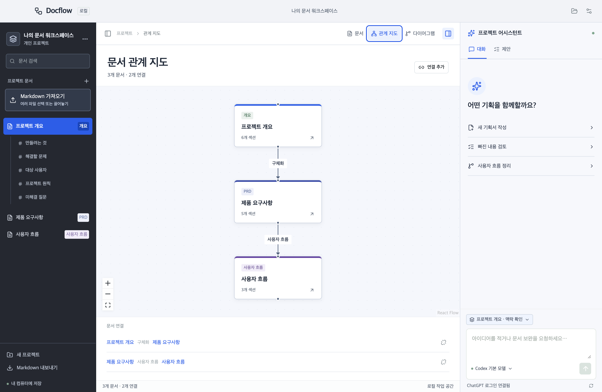
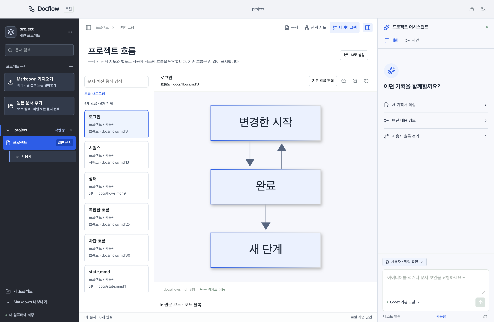

# Docflow

**문서를 읽고, 관계를 살피고, AI의 변경 제안을 검토하는 로컬 데스크톱 워크스페이스.**

Docflow는 기획 문서와 결정이 여러 파일에 흩어지는 문제를 줄이기 위한 도구입니다. Markdown 원본을 로컬에 보관하고 문서 간 관계와 흐름을 탐색합니다. AI가 제안한 변경은 근거와 차이를 확인한 뒤 직접 수락하거나 거절합니다.

> 현재는 비공개 저장소에서 오픈소스 공개를 준비하고 있습니다. 초기 개발 버전이며 설치 파일은 서명·공증되지 않았습니다. 앱의 Claude API 실계정 생성 검증과 타 플랫폼 실기기 검증은 남아 있습니다.


## 할 수 있는 일

- Markdown 작성·편집·내보내기, 목차 탐색
- 여러 Markdown 파일 가져오기, 드래그앤드롭, 저장 전 미리보기
- 프로젝트 폴더 열기·드롭 시 docs 탐색, 선택한 원본 Markdown 연결과 수동 파일·폴더 등록
- 문서·섹션 관계 지도와 Mermaid 흐름도 탐색
- Codex CLI 또는 Claude API 연결, 실제 제공자 모델 목록 조회·선택
- 선택 문서·관련 근거·결정·수락/거절 이력을 반영한 AI 맥락 확인
- 제안의 변경 비교, 수락·거절·수정 요청과 취소
- 외부 수정 충돌 확인, 저장 중단 복구와 로컬 처리 이력 보존
- 마우스 hover와 키보드 focus에서 상세 설명 확인

여러 프로젝트 폴더를 만들고 열 수 있습니다. 한 창에서 하나씩 작업하며 마지막 프로젝트를 복원합니다. 최근 프로젝트 목록과 동시 프로젝트 탭은 아직 없습니다.

## 실행하기

개발 실행에는 Node.js 24.11 이상(24.x), npm, Git이 필요합니다.

```sh
git clone https://github.com/JinsuBae2/docflow.git
cd docflow
npm ci
npm run dev
```

현재 저장소는 비공개이므로 clone에는 접근 권한이 필요합니다. 첫 실행에서 프로젝트 폴더를 선택하거나 **예제 프로젝트 열기**를 누르세요. AI 계정 없이도 문서 작성·가져오기·시각화를 사용할 수 있습니다.

프로젝트를 열면 하위 `docs` 폴더의 문서를 확인하고 선택해 등록할 수 있습니다. **원본 문서 추가**에서 탐색을 다시 실행하거나 프로젝트 내부 파일·폴더를 직접 선택하세요. 원본 연결은 등록 시 본문을 수정하지 않으며, 편집 후 **원본에 저장**을 눌러 표시된 경로에 반영합니다. 프로젝트 밖 파일은 기존 **Markdown 가져오기**로 사본을 저장합니다. 문서 등록은 한 번에 30개, 파일당 2MB, 전체 10MB까지 지원합니다. 탐색은 최대 10,000개 항목·500개 후보·20단계 깊이로 제한하고, 제외된 범위는 안내합니다. 원본 이동·삭제 시 기존 메타데이터와 이력은 보존하며 파일을 읽을 수 없다는 안내를 표시합니다.

## AI 연결

입력란 아래 모델 이름을 눌러 연결 설정을 엽니다. 제공자별 모델 선택은 따로 저장합니다. **연결 확인은 계정·모델 조회이며 문서 생성 요청을 보내지 않습니다.**

### Codex

Codex CLI 설치 후 터미널에서 로그인합니다.

```sh
npm install -g @openai/codex
codex login
```

앱은 로컬 `codex app-server --stdio`에 연결하며 CLI가 인증을 관리합니다. 모델 목록도 CLI에서 조회합니다. 앱은 Codex API 키나 구독 쿠키를 보관하지 않습니다.

macOS는 Homebrew와 `~/.local/bin`의 설치 위치를 탐색합니다. 다른 위치는 `DOCFLOW_CODEX_PATH`에 실행 파일의 절대 경로를 지정하세요. Windows는 네이티브 `codex.exe`가 PATH에 있어야 하며 WSL 경로는 지원하지 않습니다.

검증한 CLI 버전은 0.160.1입니다. 실험적 app-server API와 권한 프로필에 의존하므로 CLI 업데이트 후 호환성 확인이 필요합니다. 연결된 계정의 요금·사용량 조건이 적용됩니다.

### Claude

**AI 제공자 → Claude · Anthropic API**를 선택하고 [Anthropic Console](https://platform.claude.com/)에서 발급한 API 키를 입력합니다. **키 저장 및 연결 확인** 후 조회된 모델을 선택하고 설정을 저장하세요.


키는 Electron safeStorage를 사용해 OS 보안 저장소로 암호화합니다. 안전한 저장소를 사용할 수 없으면 저장하지 않습니다. 키를 다시 표시하는 API는 없으며 연결 화면에서 삭제할 수 있습니다. 개발 환경의 `ANTHROPIC_API_KEY`도 지원합니다. 저장된 키가 우선하며 앱에서 삭제해도 외부 환경 변수는 유지됩니다.

Claude API 이용 요금과 한도가 적용됩니다. Claude 구독 로그인·CLI 연결은 현재 지원하지 않습니다. 모델 목록과 오류·취소·제안 처리 흐름은 자동화된 가짜 API로 검증했으며, 앱의 API를 통한 실제 계정의 생성 성공은 아직 확인하지 않았습니다. 구조화된 응답을 지원하지 않는 모델은 사용할 수 없거나 요청 오류가 발생할 수 있습니다. 앱은 도구 실행 없이 완료된 응답을 받아 검증하며 토큰 단위 스트리밍은 제공하지 않습니다.

Gemini 연결은 구현하지 않았습니다.

## 사용 흐름

1. 프로젝트를 만들거나 기존 폴더를 엽니다.
2. 문서를 작성하거나 `.md` / `.markdown` 파일을 가져옵니다.
3. 목차, 관계 지도와 다이어그램에서 문맥을 확인합니다.
4. **맥락 확인**에서 AI에 보낼 근거를 확인하거나 제외합니다.
5. AI 제안을 비교하고 수락·거절합니다. 거절 버튼에서 이유를 입력한 뒤 **보내기**를 누르면 AI와 대화를 이어갑니다. 이유가 비어 있으면 거절만 기록하며, 답변 실패 시 제안에서 다시 요청할 수 있습니다. 수락 전에는 원본 문서를 변경하지 않습니다.





가져오기는 한 번에 30개, 파일당 2MB, 전체 10MB까지 지원합니다. ID를 포함한 저장 크기도 2MB 이하여야 합니다. 일부 저장 후 실패하면 완료된 문서는 유지하고 남은 파일부터 재시도합니다. 가져오기는 AI에 내용을 전송하지 않습니다.

## 데이터와 개인정보

프로젝트 폴더의 `documents/*.md`가 본문이고 `.workspace/`에 메타데이터와 이력을 보관합니다. **둘을 함께 백업하세요.** `docflow-id`와 `docflow-section` 주석은 안정적인 연결을 위한 식별자입니다. 외부 편집으로 삭제하면 재연결이 필요할 수 있습니다.

문서는 로컬에 저장되지만 **AI 요청 시 선택한 문서와 관련 맥락, 목표, 결정, 처리 이력이 외부 제공자로 전송됩니다.** 전송 전 내용을 확인하세요. 원문 HTML, 원격 이미지, 실행 링크와 Mermaid 클릭 명령은 표시하지 않습니다. AI에 파일 탐색·수정이나 명령 실행 도구를 제공하지 않습니다.

## AI를 활용해 제작했습니다

제작자가 요구사항과 방향을 정하고 **OpenAI Codex의 도움으로 설계·코드·테스트·문서를 작성했습니다.** 디자인 개선에는 frontend-design 스킬을 활용했습니다. AI 활용 사실과 검증 한계를 공개하며 변경과 유지보수 책임은 제작자와 기여자에게 있습니다.

- [제작 과정과 설계 선택](docs/development.md)
- [AI 활용 범위와 기여자의 공개 원칙](AI_USAGE.md)
- [한국어 기여 안내](CONTRIBUTING.md)
- [보안 정책](SECURITY.md) · [참여자 행동 규칙](CODE_OF_CONDUCT.md)
- [변경 기록](CHANGELOG.md)

## 검증과 패키징

```sh
npm run typecheck
npm test
npm run build
npm run test:e2e
npm run package
# macOS: 패키징 이후 DMG 생성
npm run make:dmg
```

UI 테스트는 임시 예제와 가짜 제공자를 사용합니다. 실계정 테스트는 별도 opt-in입니다. Claude 생성 테스트에는 `ANTHROPIC_API_KEY`와 조회한 모델의 `DOCFLOW_CLAUDE_MODEL`이 필요합니다.

```sh
# 실제 모델 목록 확인: 생성 요청 없음
DOCFLOW_MODELS=1 npm test -- tests/integration/live-models.test.ts
DOCFLOW_CLAUDE_MODELS=1 npm test -- tests/integration/live-claude.test.ts
# 실제 생성 요청: 요금 또는 계정 사용량 발생
DOCFLOW_LIVE=1 npm test -- tests/integration/live-codex.test.ts
DOCFLOW_CLAUDE_LIVE=1 npm test -- tests/integration/live-claude.test.ts
```

결과물은 `dist/`에 생성되며 Git에 포함하지 않습니다. GitHub Actions에는 macOS/Windows 검사와 수동 패키징이 있습니다. macOS arm64에서 로컬 검증하며 Windows·Intel Mac 실기기 검증, 코드 서명·공증은 남아 있습니다. 현재 다이어그램은 흐름도만 지원합니다. PDF/Word 가져오기, Git 동기화, 팀 협업은 지원하지 않습니다.

## 라이선스

Docflow 자체 코드는 [MIT License](LICENSE)로 제공합니다. 외부 라이브러리에는 각각의 원래 라이선스가 적용됩니다. [외부 소프트웨어 고지](THIRD_PARTY_NOTICES.md)에 라이선스 원문을 보존하며, Mermaid의 elkjs(EPL-2.0) 등은 별도 조건을 따릅니다. `npm run licenses`로 고지를 다시 생성할 수 있습니다. Electron과 Chromium 고지도 설치 파일에 포함합니다.
