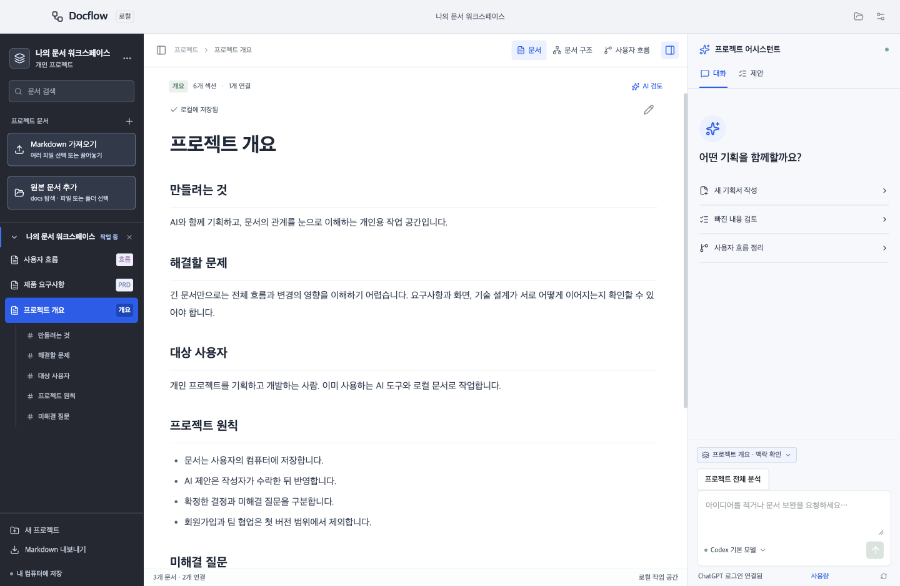
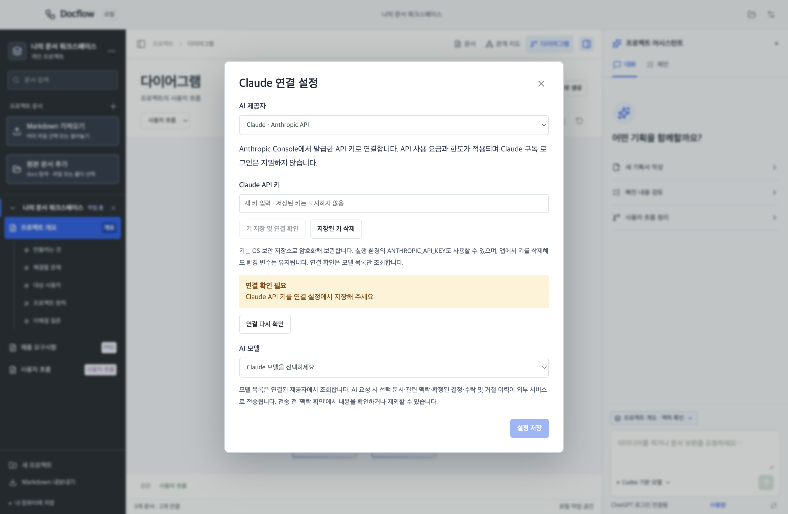
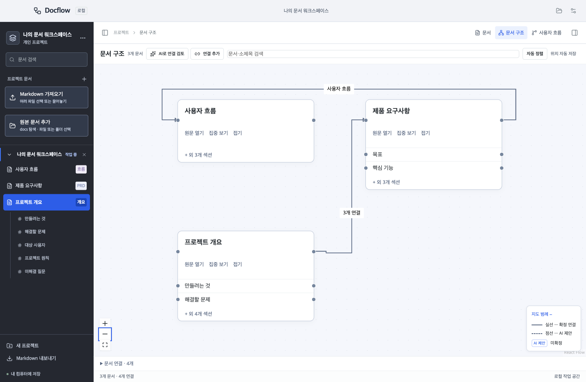
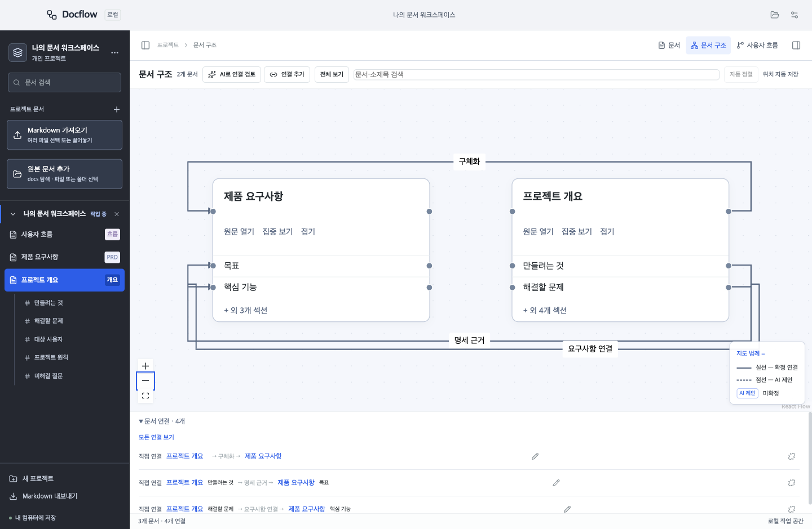
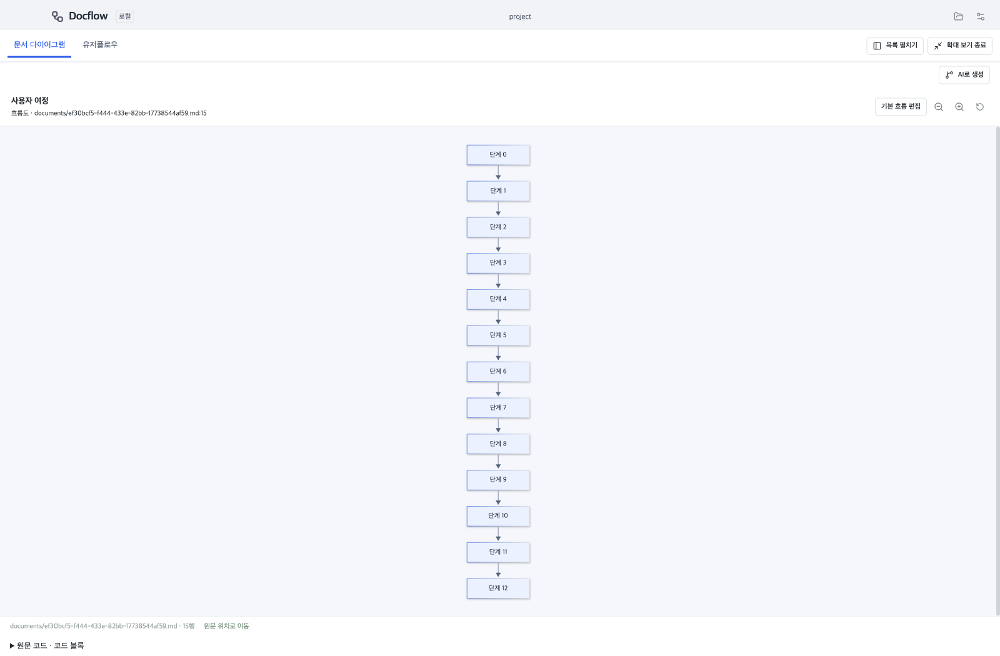
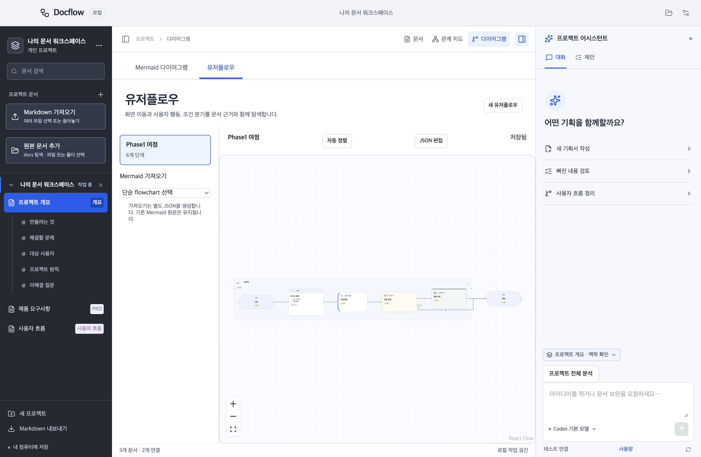
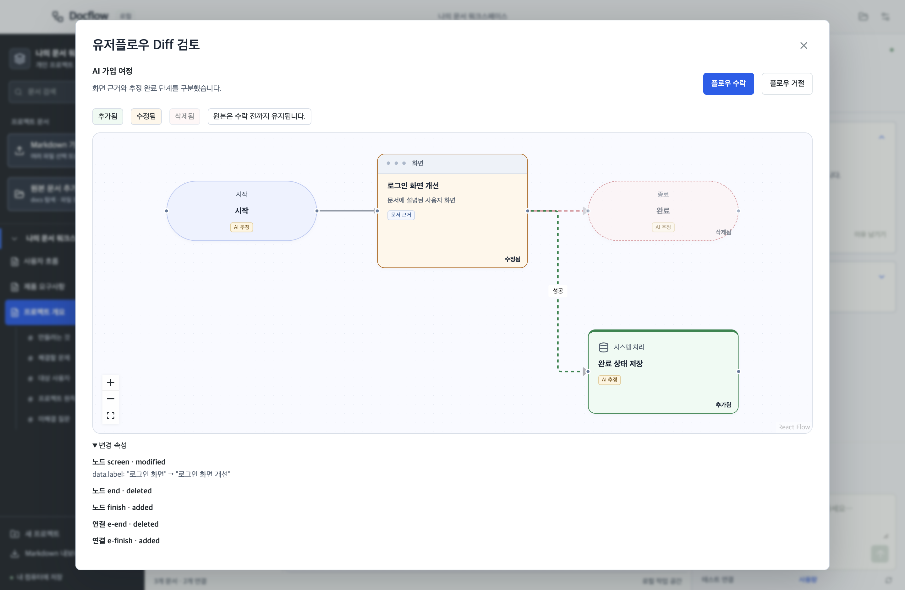

# Docflow

**프로젝트 문서를 바탕으로 구조와 사용자 흐름을 이해하고, AI와 함께 기획을 검토·발전시키는 로컬 워크스페이스.**

Docflow는 기획 문서와 결정이 여러 파일에 흩어지는 문제를 줄이기 위한 도구입니다. Markdown 원본을 로컬에 보관하고 문서 간 관계와 흐름을 탐색합니다. AI가 제안한 변경은 근거와 차이를 확인한 뒤 직접 수락하거나 거절합니다.

> MIT 라이선스로 공개된 오픈소스 저장소입니다. 초기 개발 버전이며 설치 파일은 서명·공증되지 않았습니다. 앱의 Claude API 실계정 생성 검증과 타 플랫폼 실기기 검증은 남아 있습니다.



## 할 수 있는 일

- AI 호출 없는 **프로젝트 브리핑**: 핵심 문서 후보·연결 상태·저장된 흐름·검토 항목 탐색
- Markdown 작성·편집·내보내기, 목차 탐색
- 여러 Markdown 파일 가져오기, 드래그앤드롭, 저장 전 미리보기
- 프로젝트 폴더 열기·드롭 시 docs 탐색, 선택한 원본 Markdown 연결과 수동 파일·폴더 등록
- 문서 카드 안에 핵심 섹션을 표시하는 **문서 구조**, 다중 연결 묶음·1-hop 집중 보기·배치 저장
- **사용자 흐름 → 문서 다이어그램**에서 Mermaid 흐름도·시퀀스·상태·ERD와 원문 탐색
- 독립 유저플로우 JSON, 역할별 카드·여정 그룹·ELK 자동 정렬·수동 배치 저장·문서 근거 왕복 탐색
- AI 유저플로우 생성·수정 제안, 캔버스 변경 비교와 revision 확인 후 수락·거절
- Codex CLI 또는 Claude API 연결, 실제 제공자 모델 목록 조회·선택
- 선택 문서·관련 근거·결정·수락/거절 이력을 반영한 AI 맥락 확인
- 예산 초과 시 관련 원문 섹션 자동 발췌·선택/제외 내역 검토, 빈 문서 근거 전송 차단
- 큰 프로젝트의 문서·섹션 분할 분석, 연결 근거 통합 검토, 취소·재개와 완료 묶음 재사용
- 제안의 변경 비교, 수락·거절·수정 요청과 취소
- 외부 수정 충돌 확인, 저장 중단 복구와 로컬 처리 이력 보존
- 마우스 hover와 키보드 focus에서 상세 설명 확인

왼쪽 프로젝트 목록에서 등록한 프로젝트를 접거나 펼치고 전환할 수 있습니다. 한 창에서 하나씩 작업하며 프로젝트별 문서·초안·대화 입력과 마지막 보기를 복원합니다. 동시 프로젝트 탭은 지원하지 않습니다.

## 큰 프로젝트 분석

어시스턴트의 **프로젝트 전체 분석**에서 요청·전송 문서·예산을 확인한 뒤 시작합니다. 초안 문서는 먼저 저장하거나 제외해야 합니다. 기본 맥락 예산 32,768에서 출력 8,192와 지침·응답 형식 여유 8,192를 뺀 범위에 근거를 나눕니다. UTF-8 바이트 수를 토큰 상한 추정으로 사용하며, 실제 모델의 지원 한도를 확인한 값은 아닙니다. 분석별로 예산을 조정할 수 있습니다. Claude는 출력 요청 한도에도 적용하며 Codex는 수신 후 출력 크기를 검증합니다.

완료된 묶음은 로컬에 남아 취소·앱 재시작 뒤 재개할 수 있습니다. 문서 버전·제공자·모델·입력·예산이 같은 결과만 재사용하며 여러 호출의 사용량은 각각 기록합니다. 문서나 프로젝트 맥락이 바뀌면 새 계획을 만들어야 합니다. 기존 관계와 Markdown 링크는 양쪽 관련 발췌를 함께 검토하지만 링크 없는 모든 문서 쌍의 전수 분석은 보장하지 않습니다. 누락된 근거와 제외 범위는 계획에서 확인할 수 있습니다. 발췌 수정 제안은 표시된 범위만 교체하며 전체 문서를 덮어쓰지 않습니다.

## 실행하기

개발 실행에는 Node.js 24.11 이상(24.x), npm, Git이 필요합니다.

```sh
git clone https://github.com/JinsuBae2/docflow.git
cd docflow
npm ci
npm run dev
```

첫 실행에서 프로젝트 폴더를 선택하거나 **예제 프로젝트 열기**를 누르세요. AI 계정 없이도 문서 작성·가져오기·시각화를 사용할 수 있습니다.

프로젝트를 열면 하위 `docs` 폴더의 문서를 확인하고 선택해 등록할 수 있습니다. **원본 문서 추가**에서 탐색을 다시 실행하거나 프로젝트 내부 파일·폴더를 직접 선택하세요. 원본 연결은 등록 시 본문을 수정하지 않으며, 편집 후 **원본에 저장**을 눌러 표시된 경로에 반영합니다. 프로젝트 밖 파일은 기존 **Markdown 가져오기**로 사본을 저장합니다. 문서 등록은 한 번에 30개, 파일당 2MB, 전체 10MB까지 지원합니다. 탐색은 최대 10,000개 항목·500개 후보·20단계 깊이로 제한하고, 제외된 범위는 안내합니다. 원본 이동·삭제 시 기존 메타데이터와 이력은 보존하며 파일을 읽을 수 없다는 안내를 표시합니다.

## AI 연결

입력란 아래 모델 이름을 눌러 연결 설정을 엽니다. 제공자별 모델 선택은 따로 저장합니다. **연결 확인은 계정·모델 조회이며 문서 생성 요청을 보내지 않습니다.**

### Codex

Codex CLI 설치 후 터미널에서 로그인합니다.

```sh
npm install -g @openai/codex
codex login
```

앱은 로컬 `codex app-server --stdio`에 연결하며 CLI가 인증을 관리합니다. 모델 목록도 CLI에서 조회합니다. 앱은 Codex API 키나 구독 쿠키를 보관하지 않습니다.

macOS는 Homebrew와 `~/.local/bin`의 설치 위치를 탐색합니다. 다른 위치는 `DOCFLOW_CODEX_PATH`에 실행 파일의 절대 경로를 지정하세요. Windows는 네이티브 `codex.exe`가 PATH에 있어야 하며 WSL 경로는 지원하지 않습니다.

검증한 CLI 버전은 0.160.1입니다. 실험적 app-server API와 권한 프로필에 의존하므로 CLI 업데이트 후 호환성 확인이 필요합니다. 연결된 계정의 요금·사용량 조건이 적용됩니다.

### Claude

**AI 제공자 → Claude · Anthropic API**를 선택하고 [Anthropic Console](https://platform.claude.com/)에서 발급한 API 키를 입력합니다. **키 저장 및 연결 확인** 후 조회된 모델을 선택하고 설정을 저장하세요.



키는 Electron safeStorage를 사용해 OS 보안 저장소로 암호화합니다. 안전한 저장소를 사용할 수 없으면 저장하지 않습니다. 키를 다시 표시하는 API는 없으며 연결 화면에서 삭제할 수 있습니다. 개발 환경의 `ANTHROPIC_API_KEY`도 지원합니다. 저장된 키가 우선하며 앱에서 삭제해도 외부 환경 변수는 유지됩니다.

Claude API 이용 요금과 한도가 적용됩니다. Claude 구독 로그인·CLI 연결은 현재 지원하지 않습니다. 모델 목록과 오류·취소·제안 처리 흐름은 자동화된 가짜 API로 검증했으며, 앱의 API를 통한 실제 계정의 생성 성공은 아직 확인하지 않았습니다. 구조화된 응답을 지원하지 않는 모델은 사용할 수 없거나 요청 오류가 발생할 수 있습니다. 앱은 도구 실행 없이 완료된 응답을 받아 검증하며 토큰 단위 스트리밍은 제공하지 않습니다.

Gemini 연결은 구현하지 않았습니다.

## 사용 흐름

1. 프로젝트를 만들거나 기존 폴더를 엽니다.
2. 문서를 작성하거나 `.md` / `.markdown` 파일을 가져옵니다.
3. **문서 구조**에서 관심 문서를 집중 탐색하고, **사용자 흐름**에서 동작 흐름을 확인합니다.
4. **맥락 확인**에서 AI에 보낼 근거를 확인하거나 제외합니다.
5. AI 제안을 비교하고 수락·거절합니다. 거절 버튼에서 이유를 입력한 뒤 **보내기**를 누르면 AI와 대화를 이어갑니다. 이유가 비어 있으면 거절만 기록하며, 답변 실패 시 제안에서 다시 요청할 수 있습니다. 수락 전에는 원본 문서를 변경하지 않습니다.



**문서 구조**에는 문서 카드만 배치합니다. 연결된 핵심 섹션을 카드 안에 최대 5개 먼저 표시하고 나머지는 **+ 외 N개 섹션**으로 펼칩니다. 카드 선택은 연결 상세를, **원문 열기**와 섹션 행 선택은 해당 원문을 엽니다. **집중 보기**는 기준 문서와 직접 연결된 문서만 표시하며 **전체 보기**로 돌아옵니다. 글씨가 지나치게 작아지지 않도록 최소 배율을 유지하므로 큰 지도는 이동·검색하며 탐색합니다.

같은 문서 쌍의 연결은 개수로 묶고 선택하면 개별 방향·섹션·근거를 확인합니다. 오른쪽 연결점을 문서 또는 섹션 행의 왼쪽 연결점으로 끌어 연결할 수 있습니다. 카드 이동·방향키 배치와 섹션 접기 상태는 저장됩니다. 범례의 **실선은 확정 연결**, **점선은 미확정 AI 제안**입니다. 장애물 회피 배선이 대기하거나 실패해도 곡선으로 연결을 표시합니다. 하단 연결 상세는 기본 접힘입니다.





**사용자 흐름 → 문서 다이어그램**에서는 문서·섹션·블록별 목록을 검색하고 원문 경로와 행을 확인합니다. 기존 Mermaid 흐름도·시퀀스·상태·ERD는 AI 요청 없이 표시합니다. 문서가 연결한 프로젝트 내부 `.mmd`·`.mermaid` 정의 파일도 읽기 전용으로 탐색합니다. PlantUML·DOT·D2는 원문만 표시하며 실행 엔진을 자동 설치하지 않습니다.

목록을 접거나 **다이어그램 확대 보기**를 켜면 더 넓게 탐색할 수 있습니다. 확대/축소와 화면에 맞추기를 지원하며 Escape로 확대 보기를 종료합니다. **AI로 생성**과 **사용자 흐름 정리**는 전송할 문서를 검토한 뒤 요청합니다.

**사용자 흐름 → 유저플로우**에서는 여정 그룹과 시작/종료·화면·행동·조건·시스템 단계를 구분합니다. **AI로 플로우 생성 / AI로 흐름 수정**에서 전송 맥락과 예상 사용량을 확인하고 요청하면, **캔버스 Diff 검토**에서 추가·수정·삭제와 문서 근거를 확인할 수 있습니다. 수락은 플로우와 근거 문서의 revision이 맞을 때만 저장하며 거절은 원본을 유지합니다. JSON 편집과 단순 Mermaid 가져오기도 지원합니다. 최초 배치·자동 정렬은 ELK를 사용하며 수동 좌표와 그룹 접기 상태를 `.workspace/flows/*.json`에 보관합니다.





자세한 절차는 [워크스페이스 사용 가이드](docs/workspace-guide.md), [유저플로우 작성·저장 규칙](docs/user-flow-format.md), [AI 유저플로우 제안](docs/user-flow-proposals.md)을 참고하세요. 공개 화면은 임시 예제 데이터로 촬영했으며 AI 변경 검토 화면은 가짜 제공자 테스트 결과입니다.

**기본 흐름 편집**은 Markdown의 사각 단계·방향 화살표 부분집합에 한해 단계 추가·이름 변경·삭제, 연결점 드래그 또는 키보드 연결, 방향 변경을 지원합니다. 명시적으로 저장하면 선택한 코드 블록만 바뀝니다. 문서 초안·외부 수정 충돌은 저장을 막고 편집 내용은 화면에 유지합니다. 복잡한 문법·중첩 블록·별도 정의 파일은 읽기 전용이며 원문을 보존합니다. 편집은 최대 100개 단계·200개 연결, 미리보기는 50,000자·500개 연결까지이며 한도 초과·문법 오류·실행 링크가 있으면 원문 보기로 확인할 수 있습니다.

가져오기는 한 번에 30개, 파일당 2MB, 전체 10MB까지 지원합니다. ID를 포함한 저장 크기도 2MB 이하여야 합니다. 일부 저장 후 실패하면 완료된 문서는 유지하고 남은 파일부터 재시도합니다. 가져오기는 AI에 내용을 전송하지 않습니다.

## 데이터와 개인정보

사본 문서는 `documents/*.md`, 연결한 원본은 등록된 프로젝트 내부 경로에 보관합니다. `.workspace/`에는 메타데이터·이력과 `flows/*.json` 유저플로우를 저장합니다. **원본 문서와 `.workspace/`를 포함한 프로젝트 폴더 전체를 백업하세요.** `docflow-id`와 `docflow-section` 주석은 안정적인 연결을 위한 식별자입니다. 외부 편집으로 삭제하면 재연결이 필요할 수 있습니다.

문서는 로컬에 저장되지만 **AI 요청 시 선택한 문서와 관련 맥락, 목표, 결정, 처리 이력이 외부 제공자로 전송됩니다.** 전송 전 내용을 확인하세요. 원문 HTML, 원격 이미지, 실행 링크와 Mermaid 클릭 명령은 표시하지 않습니다. AI에 파일 탐색·수정이나 명령 실행 도구를 제공하지 않습니다.

## AI를 활용해 제작했습니다

제작자가 요구사항과 방향을 정하고 **OpenAI Codex의 도움으로 설계·코드·테스트·문서를 작성했습니다.** 디자인 개선에는 frontend-design 스킬을 활용했습니다. AI 활용 사실과 검증 한계를 공개하며 변경과 유지보수 책임은 제작자와 기여자에게 있습니다.

- [제작 과정과 설계 선택](docs/development.md)
- [AI 활용 범위와 기여자의 공개 원칙](AI_USAGE.md)
- [한국어 기여 안내](CONTRIBUTING.md)
- [보안 정책](SECURITY.md) · [참여자 행동 규칙](CODE_OF_CONDUCT.md)
- [변경 기록](CHANGELOG.md)

## 검증과 패키징

```sh
npm run lint
npm run format:check
npm run typecheck
npm test
npm run build
npm run test:e2e
npm run package
# macOS: 패키징 이후 DMG 생성
npm run make:dmg
```

UI 테스트는 임시 예제와 가짜 제공자를 사용합니다. 실계정 테스트는 별도 opt-in입니다. Claude 생성 테스트에는 `ANTHROPIC_API_KEY`와 조회한 모델의 `DOCFLOW_CLAUDE_MODEL`이 필요합니다.

```sh
# 실제 모델 목록 확인: 생성 요청 없음
DOCFLOW_MODELS=1 npm test -- tests/integration/live-models.test.ts
DOCFLOW_CLAUDE_MODELS=1 npm test -- tests/integration/live-claude.test.ts
# 실제 생성 요청: 요금 또는 계정 사용량 발생
DOCFLOW_LIVE=1 npm test -- tests/integration/live-codex.test.ts
DOCFLOW_CLAUDE_LIVE=1 npm test -- tests/integration/live-claude.test.ts
```

`npm run build` 후 `npm run screenshots`로 계정 없이 공개 예제 화면을 다시 촬영할 수 있습니다. AI 변경 검토 이미지는 가짜 제공자 E2E에서 별도로 생성합니다.

결과물은 `dist/`에 생성되며 Git에 포함하지 않습니다. GitHub Actions에는 macOS/Windows 검사와 수동 패키징이 있습니다. macOS arm64에서 로컬 검증하며 Windows·Intel Mac 실기기 검증, 코드 서명·공증은 남아 있습니다. PDF/Word 가져오기, Git 동기화, 팀 협업은 지원하지 않습니다.

## 라이선스

Docflow 자체 코드는 [MIT License](LICENSE)로 제공합니다. 외부 라이브러리에는 각각의 원래 라이선스가 적용됩니다. [외부 소프트웨어 고지](THIRD_PARTY_NOTICES.md)에 라이선스 원문을 보존하며, ELK 레이아웃에 사용하는 elkjs(EPL-2.0) 등은 별도 조건을 따릅니다. `npm run licenses`로 고지를 다시 생성할 수 있습니다. Electron과 Chromium 고지도 설치 파일에 포함합니다.
