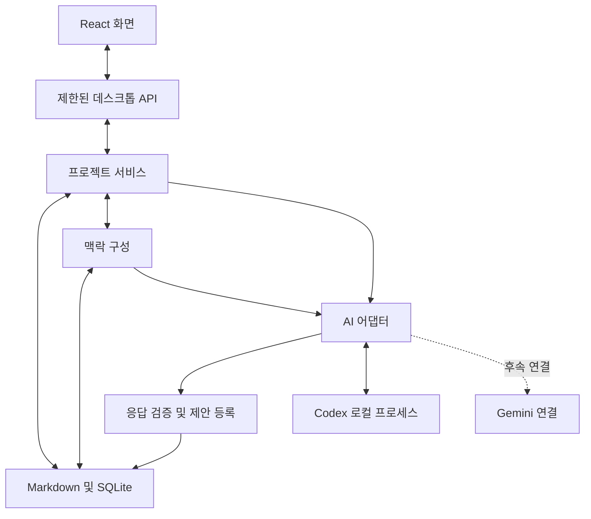

# 개인용 시각적 문서 워크스페이스 아키텍처

> 초기 설계 기록입니다. 당시의 계획과 완료 상태를 보존하며, 현재 화면과 지원 기능은 [워크스페이스 사용 가이드](workspace-guide.md)와 [README](../README.md)를 기준으로 확인하세요.

설계서 v0.2 | 2026-10-12 | Electron 선택 확정, 구현 전

## 1. 목표와 첫 구현 범위

macOS와 Windows에 설치하는 로컬 앱이다. 사용자는 AI와 새 문서를 만들고, 기존 문서의 맥락에 근거한 보완 제안을 검토한다. 문서와 다이어그램을 연결해 전체 흐름을 이해하며, 작성자가 수락한 변경만 확정 문서에 반영한다.

첫 구현은 하나의 프로젝트 안에서 다음 흐름을 끝까지 검증한다.

1. 아이디어로 PRD 초안을 생성하거나 Markdown 문서를 가져온다.
2. PRD와 기능 명세 두 문서를 제목별로 탐색하고 연결한다.
3. 두 문서와 확정된 결정을 근거로 AI에 보완을 요청한다.
4. 제안의 근거, 변경 전후, 관련 문서를 확인한다.
5. 제안을 수락하거나 거절한다.
6. 다시 요청할 때 최신 문서와 처리한 판단이 맥락에 포함되는지 확인한다.

실제 AI 연결 하나를 포함해야 이 흐름을 완료한 것으로 본다. 고정 예제 응답은 개발·테스트에만 사용하며 실제 AI 결과로 표시하지 않는다. Gemini 연결과 나머지 문서 유형은 이후 확장하되, 데이터 구조는 특정 AI나 문서 유형에 종속되지 않게 한다.

## 2. 기술 선택과 대안

사용자 확인에 따라 Electron + React + TypeScript로 구현한다. 데스크톱 파일 처리와 로컬 AI 프로세스 연결을 TypeScript 중심으로 구현한다. 화면은 로컬에 번들링하며 별도 웹 서버를 운영하지 않는다.

Tauri는 배포 크기를 줄일 수 있지만 Rust와 시스템 WebView 환경을 함께 다루어야 한다. 이번에는 파일·AI 연결의 초기 검증과 유지보수 단순성을 우선해 Electron을 선택했다. 이는 설계 선택이며 성능 측정 결과는 아니다.

본문은 Markdown, 프로젝트 구조와 이력은 SQLite로 저장한다. Markdown은 표준 파서의 구문 트리로 처리한다. 관계 지도와 다이어그램은 기존 라이브러리를 사용하며, 렌더링 및 레이아웃 엔진을 직접 만들지 않는다. 패키지 버전은 구현 시 호환성과 라이선스를 확인하고 고정한다.

## 3. 구성 요소와 책임

| 구성 요소 | 책임 | 주요 입력·출력 |
| --- | --- | --- |
| 화면 | 문서, 지도, 다이어그램, 대화, 제안 검토 | 사용자 명령과 표시 데이터 |
| 데스크톱 API | 화면과 로컬 기능 사이의 제한된 통신 | 검증된 명령과 결과·진행 이벤트 |
| 프로젝트 서비스 | 문서 변경, 연결 관리, 제안 처리 | 문서 버전 및 변경 결과 |
| 저장 계층 | 파일·DB 저장과 재시작 시 복구 | 본문, 메타데이터, 이력 |
| 맥락 구성 | 작업에 필요한 원문·결정·이력 선택 | 출처와 버전을 가진 맥락 묶음 |
| AI 어댑터 | 연결 확인, 요청, 취소, 오류 변환 | 응답 이벤트 및 제안 초안 |
| 응답 검증 | 응답 형식과 참조 검증 | 검토 가능한 제안 또는 명시적 오류 |

화면에는 파일 시스템이나 임의 명령 실행 권한을 직접 제공하지 않는다. 파일 접근과 AI 실행은 데스크톱 측에서 수행한다. 문서·AI 응답의 HTML과 다이어그램은 실행 가능한 코드로 취급하지 않는다.

## 4. 화면 구성

- 왼쪽: 프로젝트 문서 목록과 선택한 문서의 제목 계층.
- 가운데: 본문 편집·미리보기, 관계 지도, 다이어그램 사이의 보기 전환.
- 오른쪽: 현재 작업의 대화, 전달할 맥락 확인, 검토 대기 제안.
- 제안 검토: 근거, 원문과 수정안, 관련 문서, 수락·거절·수정 요청.

문서 생성과 가져오기를 모두 시작점으로 제공한다. 관계 지도에서 항목을 선택하면 본문 위치로 이동한다. 다이어그램 요소도 근거 섹션으로 이동한다. 단순 선택이나 보기 전환은 AI 요청을 발생시키지 않는다.

## 5. 저장과 데이터 모델

프로젝트 폴더에는 `documents/`의 Markdown과 `.workspace/`의 SQLite·복구 자료를 저장한다. 앱 환경설정은 OS별 앱 데이터 경로에 두고, 개인 프로젝트를 앱 소스 저장소와 분리한다. 인증정보는 프로젝트 DB나 Markdown에 저장하지 않는다.

| 데이터 | 핵심 필드와 규칙 |
| --- | --- |
| Project | ID, 이름, 목표, 제약, 포함·제외 범위 |
| Document | ID, 유형, 상대 경로, 본문 해시, 버전 |
| Section | ID, 문서 ID, 상위 섹션 ID, 제목, 순서, 내용 해시 |
| Relation | 출발·도착 ID, 관계 유형, 확인 상태 |
| Decision | 결정 내용, 근거, 상태, 관련 문서·섹션 |
| Conversation | 메시지, 요청 ID, 사용한 맥락 묶음 |
| Proposal | 종류, 대상 ID, 기준 버전, 변경안, 근거, 의존 제안, 처리 상태 |
| ContextSnapshot | 전달한 내용, 출처 ID·버전, 제외 항목, 생성 시각 |
| Diagram | 유형, 정의, 원문 요소와의 연결, 기준 문서 버전 |

본문의 기준은 Markdown 하나다. DB에는 본문 복제본을 별도 편집 가능한 원본으로 두지 않는다. 제목 계층과 위치는 본문에서 다시 계산할 수 있고, 문서·섹션 ID 및 판단 이력은 DB에서 유지한다.

문서의 frontmatter에 문서 ID를, 관리되는 제목 바로 앞의 Markdown 주석에 섹션 ID를 기록한다. 가져올 때는 반영 내용을 보여주고 ID를 부여한다. 제목 변경이나 이동에도 ID가 유지된다. 외부 수정으로 ID가 사라지면 조용히 다른 섹션과 연결하지 않고 재연결이 필요한 상태로 표시한다.

외부 수정은 파일 감지와 다시 열기 시 해시 검사로 확인한다. 편집 중 외부 변경이 발견되면 덮어쓰기 대신 비교 후 해결한다. 제목 분할은 표준 Markdown 파싱 결과를 기준으로 하며 코드 블록 안의 `#`는 제목으로 취급하지 않는다.

## 6. 맥락 구성 규칙

프로젝트의 목표·제약·확정 결정과 작업 대상 원문을 우선한다. 이후 직접 연결된 관련 문서와 관련 제안 처리 이력을 포함한다. 요청마다 전달 내용을 미리 확인하고 조정할 수 있다.

첫 버전은 명시적 연결과 키워드 검색을 사용한다. 벡터 DB나 자동 장기 기억은 도입하지 않는다. 관련 문서가 없으면 검색 후보를 제시하고, 추정 연결을 확정 연결로 저장하지 않는다.

전달 용량은 연결 도구의 한도에 맞춰 제한한다. 우선순위가 낮은 내용이 제외되면 표시한다. 필요한 근거를 모두 담지 못하면 대상 범위를 좁히거나 별도 요청으로 나눈다. 요약은 원문 출처와 버전을 유지하고, 요약만으로 새로운 결정을 확정하지 않는다.

확정 문서, 작성 중 초안, 검토 대기 제안, 거절된 제안을 구분한다. 거절 이력은 과거 판단으로 제공하며 영구적인 금지로 해석하지 않는다. 새로운 근거로 다시 제안할 때는 이전 거절과 달라진 이유를 표시한다.

요청에 사용한 맥락 묶음을 저장해 '왜 이 제안이 나왔는지' 추적한다. 응답에 실제 전달하지 않은 출처 ID가 있으면 유효한 근거로 표시하지 않는다.

## 7. AI 연결과 제안 처리

첫 연결 후보는 Codex app-server다. 공식 인터페이스를 사용하는 별도 로컬 프로세스로 연결하고 요청·응답·취소·연결 종료를 관리한다. CLI 설치와 로그인이 필요한 경우 앱에서 조건과 상태를 안내한다. 구독으로 실제 이용 가능한지와 Windows 동작은 직접 검증하기 전까지 확정하지 않는다.

AI 어댑터는 `상태 확인`, `요청 실행`, `취소`, `연결 종료` 기능을 제공한다. 출력은 설명과 구조화된 제안으로 나누며 문서 본문을 직접 수정할 권한은 주지 않는다. 문서 자동 적용은 앱의 프로젝트 서비스만 수행한다. 도구 측 파일 쓰기와 명령 실행은 비활성화하는 구성의 가능 여부를 연결 검증에 포함한다.

제안 종류는 새 문서 생성, 섹션 추가·수정, 관계 추가, 결정 변경으로 시작한다. 형식, 대상 ID, 기준 버전, 출처, 제안 간 의존 관계를 검증한 뒤 등록한다. 형식이 잘못되면 오류와 재시도를 제공하고 부분 응답을 자동 적용하지 않는다.

제안 상태는 `검토 대기`, `수락`, `거절`, `대체됨`, `재검토 필요`다. 수정 요청은 원래 제안을 유지한 채 후속 제안을 만들며, 후속안이 생성되면 이전 안을 대체된 상태로 바꾼다. 원문 버전이 달라지면 재검토가 필요하고 적용을 막는다.

수락 시 기준 버전을 다시 검사하고 새 본문을 준비한다. 파일과 SQLite는 하나의 트랜잭션이 아니므로, 작업 기록과 이전 파일을 먼저 남기고 파일을 교체한 뒤 DB에 적용 상태를 기록한다. 각 단계는 재실행 가능하게 만들며 재시작 시 미완료 작업을 복구한다. 완료 전에는 수락 성공을 표시하지 않는다.

처음에는 한 제안을 하나의 대상 문서에 적용한다. 여러 문서를 바꾸는 요청은 연결된 개별 제안으로 나누고 선행 제안이 수락된 뒤 다음 제안을 최신 맥락으로 다시 검토한다. 거절은 문서를 바꾸지 않고 처리 이력만 남긴다.

## 8. 다이어그램과 문서 일관성

문서 관계 지도는 확인된 관계 데이터로 표시한다. 내용 다이어그램은 편집 가능한 정의와 원문 섹션 연결을 저장한다. AI가 만든 다이어그램도 검토 후 저장한다.

관련 문서 버전이 바뀌면 다이어그램을 '갱신 필요'로 표시한다. 의미가 바뀌는 자동 재생성은 제안으로 처리한다. 첫 버전은 사용자 흐름도 한 유형을 지원하고 시스템 구성도 등은 후속 범위로 둔다.

## 9. 오류와 데이터 보호

AI 연결 없음, 로그인 만료, 사용량 제한, 응답 형식 오류, 취소는 구분해서 표시한다. 실패해도 편집한 문서는 보존한다. 재시도는 새 요청 ID로 실행하며 동일 응답 이벤트가 중복 도착해도 제안을 중복 생성하지 않는다.

파일 경로는 현재 프로젝트 범위 안에서 검증한다. 문서 안의 지시문은 자료로 취급하며 앱 권한을 바꿀 수 없다. 기록에는 인증 토큰을 남기지 않는다. AI에 전달할 원문과 로컬 보관 이력은 사용자가 확인할 수 있다.

## 10. 검증과 배포 기준

첫 구현의 집중 검증 대상은 Markdown 제목 파싱, ID 유지, 맥락 선택과 출처, 수락·거절 상태, 버전 충돌, 저장 중단 복구다. 테스트는 이 행동과 데이터 보존을 확인하며 화면의 정적인 장식은 대상으로 삼지 않는다.

실제 AI로 PRD에서 기능 명세를 생성하고, 두 문서에 근거한 제안 하나를 수락하고 하나를 거절한 뒤 다음 요청의 맥락을 확인한다. 재시작 후 문서·관계·판단 이력이 유지되어야 한다.

macOS와 Windows에서 빌드·실행·저장·AI 연결을 각각 확인한다. 현재 macOS 환경에서의 성공만으로 Windows 실행 성공을 주장하지 않는다. GitHub Actions의 빌드 검사와 실제 설치·실행 검증을 구분한다.

공개 준비에는 README, 개발·설치 방법, 예제 프로젝트, 라이선스 선택, 기여 안내, OS별 빌드 자동화를 포함한다. 라이선스는 소유자가 선택하기 전 임의로 부여하지 않는다. 설치 파일 서명과 macOS 공증에 필요한 계정·인증서 확보는 공개 릴리스 단계에서 진행한다.

## 11. 구현 단계와 이번 단계의 경계

1. AI 연결 검증: Codex 연결, 인증 상태, 문맥 전달, 구조화된 응답, 쓰기 제한과 취소 확인.
2. 데이터와 맥락: 문서 저장, 제목 구조, ID, 연결, 결정·제안 이력 구현.
3. 데스크톱 작업 흐름: 편집·탐색·대화·제안 검토와 수락·거절 연결.
4. 시각화: 관계 지도, 흐름도, 원문 이동과 갱신 필요 표시.
5. 공개 준비: OS별 검증과 배포 문서·자동화.

각 단계는 바로 앞 단계에서 확인한 연결 제약을 반영한다. AI 연결이 지원되지 않으면 지원되는 대안을 제시하고 실제 연결 없이 전체 구현이 완료됐다고 보고하지 않는다.

이번 산출물은 아키텍처 설계서다. 구현 계획과 제품 코드는 아직 작성하지 않았다. 현재 폴더에는 Git 저장소가 없으므로 이 설계서의 커밋은 수행하지 않았다.

## 12. 근거 문서

- Electron 프로세스 모델: https://www.electronjs.org/docs/latest/tutorial/process-model
- Electron 패키징: https://www.electronjs.org/docs/latest/tutorial/tutorial-packaging
- Tauri 구조와 배포: https://v2.tauri.app/start/ 및 https://v2.tauri.app/distribute/
- Codex app-server: https://learn.chatgpt.com/docs/app-server
- Codex 인증: https://developers.openai.com/codex/auth/

공식 인터페이스의 존재와 이 프로젝트에서의 실제 사용 가능성은 구분한다. 설치 버전, 계정 조건, OS별 실행과 권한 제한은 첫 검증 단계에서 확인한다.
