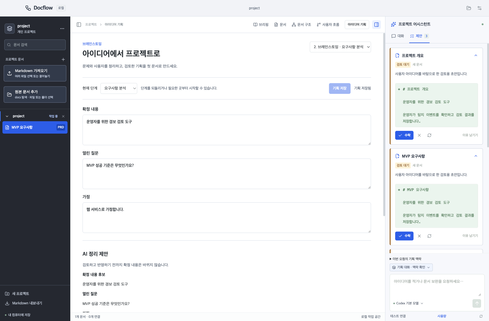

# 아이디어에서 프로젝트로 검증 기록

이슈 #46, 브랜치 `feat/46-idea-to-project`, 기준 main `e51d8cb`.

## 변경과 결정

- 빈 프로젝트 또는 제목만 있는 문서 상태에서 브레인스토밍/계획을 시작한다. 기존 문서가 있는 프로젝트에서도 기획을 열 수 있다.
- 문제 정의·MVP 범위·요구사항·사용자 시나리오·구현 및 검증 단계와 확정 내용·질문·가정을 기존 SQLite records에 별도로 저장한다. 기존 문서나 DB 스키마를 마이그레이션하지 않는다.
- 같은 세션의 이전 대화를 다음 요청에 포함한다. 사용자 설명은 제공자 연결 전에 저장하며 실패해도 보존한다. AI 정리는 후보로만 저장하고 명시적으로 반영한다.
- 사용자 요청에 따라 요청 예산 입력·일반 대화 전송 확인을 제공하지 않는다. 내부 60,000자 크기는 구독 토큰 한도가 아니다. 긴 대화는 턴 단위로 선별하며 제외 안내와 전체 로컬 기록을 유지한다.
- 같은 기획에서 생성한 create 제안만 수정·거절 검토로 이어간다. 다른 세션/기존 문서/유저플로우는 기획 맥락에 섞지 않는다. 문서는 기존 제안 수락 경로로 저장한다.

## 검증

| 항목 | 결과 |
| --- | --- |
| 타입 검사·ESLint·Prettier | 통과 |
| 전체 단위/통합 테스트 | 42개 파일 통과·5개 건너뜀, 185개 테스트 통과·6개 건너뜀 |
| Electron 빌드 | 통과 |
| 기획 E2E | 두 턴·재실행 복원·AI 정리 반영·초안 수정/거절/일부 수락·세션 격리 통과 |
| 긴 대화·실패 | 60,000자를 넘는 한국어/이모지 대화 보존·비차단 제외 안내·실패 후 이어가기·취소 시 사용자 설명만 보존 통과 |
| 창 크기 | 800×700·1280×800·1600×1050에서 단계/문서화 조작 접근 및 가로 넘침 없음 |
| 전체 Electron E2E | 27개 통과 |
| 별도 읽기 전용 리뷰 | 미저장 기획의 같은 문서/섹션 이동 보호 누락 1건 발견, 회귀 테스트 RED→GREEN 및 전체 E2E 통과 |

기획 UI 부재와 같은 세션 제안 수정의 차단을 실패 테스트로 확인한 뒤 구현했다. 제안 배지의 개수를 포함하는 접근성 이름에 맞춰 E2E 선택자를 수정했다. 전체 E2E 초기 실행에서 사용량 예제가 제목뿐이라 새 시작 조건에 들어가는 실패 1건을 확인했다. 사용량 검증 목적에 맞춰 예제에 본문을 추가한 뒤 관련 3개 E2E가 통과했다. 취소 테스트는 합성 응답이 먼저 끝나는 경합을 피하도록 취소할 요청의 fixture 응답만 10초 지연한다. 실제 앱 요청에는 지연을 추가하지 않았다.

## 범위와 제한

테스트는 임시 프로젝트와 가짜 Codex/Claude 제공자를 사용했다. 실제 AI 생성 품질과 Windows 실기기 화면은 확인하지 않았다. 개인정보·실제 인증정보·사용자 DB를 포함하지 않았다. 기존 stash는 보존했다. main 머지, 설치본 교체, 자동 업데이트 및 공개 Release는 이 PR에서 수행하지 않았다. 원격 macOS/Windows CI와 PR 제목 검사 결과는 PR Checks에서 확인한다.
