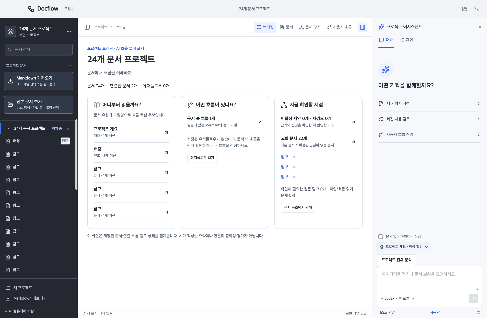

# 워크스페이스 사용 가이드

현재 구현 기준: 아이디어 기획·프로젝트 브리핑·기획 펼치기와 연결 탐색·문서 다이어그램·AI 유저플로우 제안. 과거 날짜의 설계·검증 문서는 당시 기록이며 이 가이드와 README가 현재 사용법을 설명합니다.

## 프로젝트와 문서 등록

1. 프로젝트 폴더를 열거나 창에 끌어놓습니다. 처음에는 예제 프로젝트로 계정 없이 둘러볼 수 있습니다.
2. 발견한 `docs` 문서 중 등록할 원본을 선택합니다. 나중에 **원본 문서 추가**에서 재탐색하거나 프로젝트 내부 파일·폴더를 직접 선택할 수 있습니다.
3. 연결한 원본은 등록할 때 수정하지 않습니다. 편집 후 **원본에 저장**으로 표시된 경로에 반영합니다. 프로젝트 밖 Markdown은 **Markdown 가져오기**로 사본을 만듭니다.
4. 왼쪽 목록은 숫자를 인식해 정렬합니다. 기본 일반 문서 배지는 숨기고 명시한 유형이나 파일명에서 추론한 분류만 표시합니다. 표시용 추론은 저장된 문서 유형을 바꾸지 않습니다.

프로젝트 목록을 접고 펼치거나 다른 등록 프로젝트로 전환할 수 있습니다. 작업 중인 초안과 대화 입력은 프로젝트별로 복원합니다. 동시에 여러 프로젝트를 여는 탭은 지원하지 않습니다.

## 브리핑으로 시작하기

처음 프로젝트를 열면 **브리핑**에서 핵심 문서 후보, 연결된 문서 수, 고립 문서, 문서 속 흐름·저장된 유저플로우와 미확정·재검토 제안을 확인합니다. 문서 유형·파일명과 저장된 상태만 집계하므로 AI를 호출하지 않습니다. 각 항목에서 원문·문서 구조·흐름·제안으로 이동할 수 있습니다. 앱을 다시 실행하면 기존 문서/흐름 보기와 초안을 복원하며 상단 **브리핑**으로 돌아갈 수 있습니다.

## 아이디어에서 첫 문서 만들기

문서가 없거나 제목만 있는 빈 프로젝트에서는 **브레인스토밍 시작**과 **바로 계획 세우기**를 선택할 수 있습니다. 바로 대화 입력을 보내도 브레인스토밍 세션을 시작합니다. 기존 문서가 있는 프로젝트에서도 상단 **아이디어 기획**을 열 수 있습니다.

1. 브레인스토밍은 문제와 사용자를 발견하는 단계부터, 계획은 MVP 범위부터 시작합니다. 문제·사용자 → MVP 범위 → 요구사항 → 사용자 시나리오 → 구현·검증 계획 순서로 발전시키되 필요한 단계로 이동하거나 돌아갈 수 있습니다.
2. 확정 내용·열린 질문·가정을 직접 수정하고 **기획 저장**을 누르세요. AI의 정리는 후보로 표시되며 **AI 정리 반영**을 눌러야 저장한 정리가 바뀝니다.
3. 대화는 현재 기획 세션의 이전 답변과 저장한 정리를 이어받습니다. 세션과 프로젝트 사이에 대화를 섞지 않으며 앱 재실행 후 복원합니다. 별도 요청 예산 입력이나 일반 대화 전 확인은 없습니다. 긴 대화는 완전한 턴 단위로 선별하고 제외 사실을 안내하며 전체 기록은 로컬에 보존합니다. 중요한 결정은 기획 정리에 저장하세요.
4. **문서 초안 작성**은 기본적으로 개요·MVP 요구사항·사용자 시나리오를 제안합니다. 요청 문구를 조정할 수 있으며 제안에서 수정 요청·거절·수락합니다. 수락한 문서만 실제 프로젝트에 저장됩니다. 이후 저장한 문서를 근거로 문서 구조·사용자 흐름을 발전시키세요.

기획 중에는 다른 문서를 AI 근거로 자동 첨부하지 않습니다. 기존 문서의 검토와 사용자 흐름 생성은 해당 화면에서 근거를 확인한 뒤 요청하세요. Codex 연결은 로그인한 계정의 사용 한도를, Claude API 연결은 해당 API 계정의 과금·한도를 따릅니다. 앱의 맥락 크기 제한은 구독 토큰 잔액을 뜻하지 않습니다.

## AI에 전달할 원문 확인

일반 요청의 기본 맥락 한도는 직렬화한 JSON 기준 60,000자입니다. 필수 문서가 넘치면 요청 키워드와 제목·목차의 관련도를 기준으로 실제 원문 섹션을 선택합니다. 여러 문서가 있으면 문서별 근거 공간을 먼저 배분하고 한 발췌가 과도하게 차지하지 않도록 최대 8,000자로 제한합니다. 이후 관련 문서의 보조 발췌는 최대 4,000자씩 선택합니다. 모델 자체의 컨텍스트 한도나 과금 토큰 수와는 별개입니다.

자동 발췌 요청은 전송 전에 **맥락 확인**을 엽니다. 선택된 섹션·원문 범위·revision, 제외한 섹션과 이유를 확인하고 **검토한 근거로 요청**을 누르세요. 제목·요약을 새로 생성하지 않으며 원본 범위를 그대로 보냅니다. **제외**와 문서 체크박스로 조정할 수 있고, 그 사이 근거가 변경되면 재확인을 요구합니다. 요청 후에는 **이번 요청의 원문 근거**에서 실제 전송 범위를 확인할 수 있습니다.

유효한 원문이 하나도 없는 문서 요청은 제공자 호출 전에 차단합니다. 문서와 무관한 기획 상담은 **문서 없이 아이디어 상담**을 선택하세요. 이 모드는 문서 기반 검토나 플로우 생성과 구분됩니다. 예산 때문에 이전 결정·처리 이력을 줄이면 제외 건수를 표시합니다. 큰 프로젝트를 빠짐없이 검토하려면 **프로젝트 전체 분석**으로 분할 검토하세요.

## 문서 구조에서 탐색

기본 **기획 펼치기**는 기획 문서를 분류하고 동일 본문을 묶어 보여 줍니다. 문서 카드를 선택해 원문 순서의 항목을 펼치고, 항목의 상세보기에서 카드 옆 Markdown과 원문 위치를 확인합니다. 항목이 많으면 페이지를 넘겨 탐색합니다. **기획·설계 문서만**을 해제하면 전체 문서를 볼 수 있고 **같은 본문 묶기**로 중복 표시를 조정합니다.

**연결 탐색**으로 전환하면 기존 관계를 확인·편집합니다. 아래의 집중 보기·연결점·배치 저장 설명은 연결 탐색에 해당합니다.

캔버스는 문서 단위 카드로 구성합니다. 프로젝트 루트와 개별 소제목을 별도 노드로 나열하지 않습니다. 문서의 전체 목차는 원문 보기에서 확인할 수 있습니다.

- **카드 선택:** 선택 문서의 개별 연결 상세를 엽니다.
- **원문 열기 / 섹션 행:** 해당 문서 또는 섹션으로 이동합니다.
- **핵심 섹션:** 실제 연결이 있는 섹션을 최대 5개 먼저 표시합니다. **+ 외 N개 섹션**으로 나머지를 펼치고 **핵심 섹션만 보기**로 되돌립니다.
- **접기 / 펼치기:** 섹션 행을 숨기면 선을 카드 경계로 모읍니다. 다시 펼치면 표시되는 섹션 행 연결점으로 복원합니다. 원본 연결 ID는 바뀌지 않습니다.
- **N개 연결:** 같은 문서 쌍의 연결을 묶어 표시합니다. 선택하면 각 연결의 방향·섹션·근거를 확인합니다. 확정 연결과 미확정 AI 제안은 섞지 않습니다.
- **집중 보기:** 기준 문서와 직접 연결된 1-hop 문서만 표시하고 기준 카드를 중심으로 정렬합니다. **전체 보기**로 전체 문서에 돌아옵니다. 집중 보기의 임시 배치가 전체 지도 좌표를 덮어쓰지 않습니다.

카드는 마우스 드래그나 선택 후 방향키로 이동합니다. 위치와 접기 상태는 자동 저장하며 **자동 정렬**은 확인 후 수동 배치를 바꿉니다. 큰 지도는 글씨가 지나치게 작아지지 않도록 최소 배율 0.8을 유지합니다. 전체 카드를 한 화면에 모두 넣기보다 이동·문서/소제목 검색·집중 보기로 탐색하세요.

실선은 확정 연결, 파란 점선은 미확정 AI 제안입니다. 배선 계산 중이거나 통로가 막히면 곡선으로 즉시 표시합니다. 곡선 폴백은 장애물 회피를 보장하지 않으므로 밀집 영역은 집중 보기로 좁혀 확인하세요. 하단 **문서 연결**은 기본 접힘이며 선택한 연결을 열거나 **모든 연결 보기**로 목록을 전환할 수 있습니다.

## 연결 추가와 AI 검토

문서 또는 섹션 행의 오른쪽 연결점을 다른 왼쪽 연결점으로 끌면 연결 창이 열립니다. 같은 카드의 서로 다른 섹션도 연결할 수 있습니다. **연결 추가** 창에서 키보드로 양 끝점과 유형을 선택하는 방식도 지원합니다.

직접 연결의 유형은 상세 목록에서 수정하거나 해제합니다. 원문 Markdown 링크로 생긴 연결은 본문에서 수정·제거하며, 상세 목록에서 강제로 해제하지 않습니다.

**AI로 연결 검토**는 검토할 문서와 맥락을 확인하는 요청을 준비합니다. 실제 요청을 보내야 제공자에 전송되며 수락 전에는 원본 관계가 바뀌지 않습니다. 파란 점선이나 묶음을 선택하면 방향·제안 이유·근거 원문을 확인하고 오른쪽 제안 패널에서 수락·거절할 수 있습니다.

## 사용자 흐름의 두 보기

| 보기 | 다루는 내용 | 저장 기준 |
| --- | --- | --- |
| 문서 다이어그램 | 문서의 Mermaid 흐름도·시퀀스·상태·ERD, 연결된 정의 파일 | 원문 Markdown/정의 파일 |
| 유저플로우 | 화면 이동·행동·조건·시스템 처리와 여정 그룹 | `.workspace/flows/<id>.json` |

**문서 다이어그램**은 AI 없이 기존 정의를 표시합니다. 목록 접기·확대 보기·화면 맞춤으로 읽는 공간을 조정하며 Escape로 확대 보기를 닫습니다. 지원하는 단순 Markdown flowchart만 **기본 흐름 편집**으로 수정하고 선택한 코드 블록에 저장합니다. 복잡한 Mermaid와 별도 정의 파일은 원문을 보존하는 읽기 전용 보기입니다. PlantUML·DOT·D2는 원문만 표시합니다.

**유저플로우**는 JSON 편집, 단순 Mermaid 가져오기 또는 AI 생성으로 작성합니다. 원문과 JSON을 자동 왕복 변환하지 않습니다. 그룹 접기·수동 배치를 저장하며 **자동 정렬**을 선택할 때 ELK로 전체 배치를 계산합니다. 문서 근거 배지와 문서 하단의 연결된 플로우를 통해 양쪽으로 이동할 수 있습니다.

## AI 플로우 제안 검토

1. **AI로 플로우 생성** 또는 **AI로 흐름 수정**을 선택합니다.
2. 요청 내용·전송 문서/섹션·예상 입력 사용량을 확인하고 **검토한 맥락으로 플로우 요청**을 누릅니다.
3. **캔버스 Diff 검토**에서 초록색 추가, 주황색 수정, 붉은색 삭제와 변경 속성을 확인합니다. 문서 근거가 없는 보완 단계는 **AI 추정**으로 표시합니다.
4. **플로우 수락**은 플로우와 근거 문서 revision이 일치할 때만 저장합니다. 기존 같은 부모 노드의 수동 좌표를 보존하고 신규/이동 단계만 배치합니다.
5. **플로우 거절**은 원본을 유지합니다. 사유를 입력하면 후속 대화로 보완을 요청하고 실패 시 재시도할 수 있습니다.

[JSON 작성·저장 규칙](user-flow-format.md)과 [AI 제안·충돌·복구 동작](user-flow-proposals.md)을 참고하세요.

## 현재 한계와 백업

문서 등록과 브리핑은 AI를 호출하지 않으며 전체 유저플로우를 자동 생성하지 않습니다. 자동 원문 발췌는 예산 안의 관련 근거를 고르는 기능으로, 전체 문서의 요약이나 전수 분석을 보장하지 않습니다. 프로젝트 정보나 수정 대상 제안 자체가 예산을 넘으면 요청 범위를 줄여야 합니다.

등록된 원본 Markdown, 사본 `documents/`, `.workspace/`의 DB·이력·유저플로우를 함께 백업하세요. 기존 3열 지도 좌표는 처음 새 배치를 저장할 때 DB의 `map-view-v1` 레코드로 보존합니다. 이는 원본 문서의 버전 백업을 대신하지 않습니다.

AI 요청 시 선택한 맥락이 외부 제공자로 전송됩니다. 예산과 근거를 먼저 확인하세요. 앱의 자동 업데이트, PDF/Word 가져오기, Git 동기화와 팀 협업은 현재 지원하지 않습니다.
